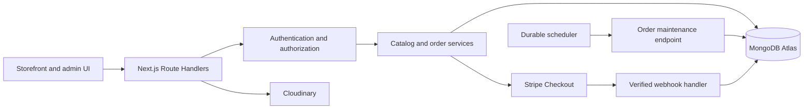

# VOLT

**Electronics commerce, from discovery to delivery.**

VOLT is a full-stack electronics storefront built with Next.js App Router and JavaScript. It combines a responsive shopping experience, customer accounts, store administration, and transaction-based inventory management in one application.

[Live storefront](https://volt-commerce-three.vercel.app) · [Admin sign-in](https://volt-commerce-three.vercel.app/admin/login) · [Architecture](ARCHITECTURE.md)

[](https://github.com/AbdulSamadAhsan/voltecommece/actions/workflows/ci.yml)

## Contents

- [Features](#features)
- [Technology](#technology)
- [Architecture](#architecture)
- [Getting started](#getting-started)
- [Environment variables](#environment-variables)
- [Accounts and access](#accounts-and-access)
- [Checkout and inventory](#checkout-and-inventory)
- [Payments and refunds](#payments-and-refunds)
- [Image uploads](#image-uploads)
- [Scheduled maintenance](#scheduled-maintenance)
- [Testing](#testing)
- [Deployment](#deployment)
- [API overview](#api-overview)
- [Operations and current scope](#operations-and-current-scope)
- [Troubleshooting](#troubleshooting)

## Features

### Storefront

- Searchable catalog with category, brand, price, sorting, and pagination controls.
- Product editions, specifications, image galleries, and availability.
- Persistent browser cart and wishlist, with account wishlist synchronization.
- Coupons, shipping estimates, server-calculated tax, and cash-on-delivery checkout.
- Optional Stripe-hosted card checkout.
- Customer addresses, order history, fulfillment status, and tracking references.
- Reviews restricted to customers with a delivered purchase.
- Responsive layouts, dark mode, loading states, notifications, and accessible form controls.
- Page metadata, product structured data, sitemap, and image optimization.

### Store administration

- Revenue, order, customer, and low-stock summaries.
- Product, category, brand, coupon, and featured-product management.
- Product image uploads and variant inventory controls.
- Order shipment, delivery, cancellation, and eligible card refunds.
- Customer account enable/disable controls and persisted administrative audit records.
- Dedicated admin sign-in; public registration creates customer accounts only.

### Account security

Both customers and administrators can change their passwords from **Profile & security**. Password fields include show/hide controls. Changes require the current password and invalidate existing sessions.

## Technology

| Area           | Implementation                                                      |
| -------------- | ------------------------------------------------------------------- |
| Application    | Next.js App Router, React, JavaScript                               |
| Styling        | Tailwind CSS, custom responsive styles, Lucide icons                |
| Server         | Node.js Route Handlers                                              |
| Database       | MongoDB Atlas and Mongoose                                          |
| Authentication | Auth.js credentials provider, bcrypt password hashing, JWT sessions |
| Validation     | Zod                                                                 |
| Card payments  | Stripe Checkout and signed webhooks                                 |
| Product media  | Cloudinary                                                          |
| Verification   | Vitest, MongoDB Memory Server, Playwright request tests             |
| Delivery       | GitHub Actions and Vercel                                           |

Auth.js is currently pinned to a v5 beta release. Use the committed lockfile for reproducible installs and review dependency updates before adoption.

## Architecture



```text
app/                 Pages, layouts, metadata, and REST endpoints
components/          Storefront, account, and admin components
lib/                 Models, queries, validation, access, pricing, and order services
scripts/             Additive seed and isolated test-server setup
public/              Static assets
tests/              Unit and database integration tests
e2e/                End-to-end HTTP tests
.github/workflows/   Verification and optional order-maintenance workflows
```

Models use a `volt_` collection prefix. The deployed application uses a dedicated `volt_commerce` database. Unique indexes protect email addresses, product slugs, SKUs, checkout keys, review ownership, and webhook event IDs. Multi-document inventory and order changes run in MongoDB transactions.

See [ARCHITECTURE.md](ARCHITECTURE.md) for the database and lifecycle design.

## Getting started

### Requirements

- Node.js 24 and npm.
- MongoDB Atlas, or a local MongoDB replica set with transaction support.
- Stripe and Cloudinary accounts only when enabling their respective features.

### Installation

```bash
git clone https://github.com/AbdulSamadAhsan/voltecommece.git
cd voltecommece
npm ci
```

Copy `.env.example` to `.env.local` using your editor, then configure the database and authentication variables below. Generate independent random values for `AUTH_SECRET` and `CRON_SECRET`:

```bash
node -e "console.log(require('node:crypto').randomBytes(32).toString('hex'))"
```

Run the command separately for each secret.

### Seed and start

```bash
npm run seed
npm run dev
```

Open [localhost:3000](http://localhost:3000).

Seeding creates the required indexes and inserts sample electronics, categories, brands, and a capped coupon. It preserves existing records, including inventory and account credentials. Configure the optional seed administrator variables before seeding if you need an initial admin account.

To run the production build locally:

```bash
npm run build
npm start
```

## Environment variables

Use `.env.local` for development and Vercel environment settings for deployed secrets. Never commit credentials. Keep production, preview, and test databases separate.

| Variable                | Purpose                                                             | Required when                                 |
| ----------------------- | ------------------------------------------------------------------- | --------------------------------------------- |
| `MONGODB_URI`           | Connection string for the application database                      | Running the application                       |
| `AUTH_SECRET`           | Auth.js token encryption secret; generate at least 32 random bytes  | Authentication                                |
| `AUTH_URL`              | Canonical application origin, including protocol                    | Authentication and mutation-origin validation |
| `NEXT_PUBLIC_SITE_URL`  | Canonical public URL for metadata and sitemap                       | Configuring a deployment                      |
| `PAYMENT_PROVIDER`      | `cod` by default; use `stripe` to enable card checkout              | Selecting payment behavior                    |
| `STRIPE_SECRET_KEY`     | Stripe server API key                                               | Card checkout and card refunds                |
| `STRIPE_WEBHOOK_SECRET` | Signing secret for the registered Stripe endpoint                   | Receiving payment events                      |
| `CLOUDINARY_CLOUD_NAME` | Cloudinary account cloud name                                       | Image uploads                                 |
| `CLOUDINARY_API_KEY`    | Cloudinary API key                                                  | Image uploads                                 |
| `CLOUDINARY_API_SECRET` | Cloudinary server secret                                            | Image uploads                                 |
| `CRON_SECRET`           | Bearer secret protecting order maintenance                          | Scheduling maintenance                        |
| `SEED_ADMIN_EMAIL`      | Initial administrator email                                         | Bootstrapping an admin                        |
| `SEED_ADMIN_PASSWORD`   | Initial administrator password, at least 16 characters              | Bootstrapping an admin                        |
| `TAX_BPS`               | Flat tax rate in basis points; default `800` means 8%               | Overriding tax policy                         |
| `SHIPPING_CENTS`        | Standard shipping charge; default `999` means $9.99                 | Overriding shipping policy                    |
| `FREE_SHIPPING_CENTS`   | Free-shipping threshold after discounts; default `15000` means $150 | Overriding shipping policy                    |

Set `AUTH_URL` and `NEXT_PUBLIC_SITE_URL` to the same canonical origin. Only `NEXT_PUBLIC_` variables are intended for browser-visible configuration; never use that prefix for credentials.

## Accounts and access

| Destination                                                          | Route          |
| -------------------------------------------------------------------- | -------------- |
| Customer sign-in and registration                                    | `/login`       |
| Customer and admin profile, security, addresses, and personal orders | `/account`     |
| Administrator sign-in                                                | `/admin/login` |
| Administrator dashboard                                              | `/admin`       |

Public registration cannot assign the admin role, including when a caller supplies an extra role field. Protected operations reload the database account so role changes, disabled accounts, and password-session revocation take effect on subsequent requests.

To bootstrap an administrator, set both seed administrator variables and run `npm run seed`. The seed password requires at least 16 characters. The application requires at least 12 characters for registration and profile password changes. Remove the seed password from the environment after setup.

Seeding does **not** promote an existing customer with the same email or reset an existing password. Handle any role promotion through an authenticated database-operator procedure.

## Checkout and inventory

The browser submits product SKUs and quantities. The server loads current prices and calculates all charges; client-supplied totals are not accepted.

- Money is stored as integer USD cents.
- Discounts apply before tax; shipping eligibility uses the discounted subtotal.
- Tax applies to the discounted merchandise subtotal under the included flat-rate policy.
- Checkout requires an `Idempotency-Key` between 16 and 100 alphanumeric or hyphen characters.
- Repeating the same checkout key and payload returns the original order. Reusing that key with different data is rejected.
- Conditional stock updates and order creation share a transaction to prevent overselling.
- Coupon usage caps participate in the same transaction.

### Reservation rules

| Payment method       | Inventory behavior                                              |
| -------------------- | --------------------------------------------------------------- |
| Cash on delivery     | Reserved immediately until fulfillment or explicit cancellation |
| Stripe               | Reserved for 30 minutes while awaiting verified payment         |
| Expired online order | Stock and coupon usage released by maintenance                  |
| Paid online order    | Confirmed stock is not released by reservation expiry           |
| Late payment         | Recorded for refund rather than fulfilling released inventory   |

Inventory shown in the admin dashboard means **units available to new orders**. Existing SKU identities must remain present when editing a product. New editions can be added. Product edits require the original `updatedAt` value to prevent stale edits from overwriting concurrent reservations.

Products are archived rather than deleted, preserving their order history.

## Payments and refunds

### Cash on delivery

COD works without Stripe configuration. Orders are confirmed at checkout, and payment is recorded when an administrator marks the order delivered. Cash refunds require an offline operating procedure.

### Stripe sandbox

1. Set `PAYMENT_PROVIDER=stripe` and configure a Stripe test secret key.
2. Register the webhook endpoint and set its matching signing secret.
3. Configure frequent order maintenance and initialize its heartbeat.
4. Exercise test-mode checkout, webhook retries, expiry, and refunds before enabling live payments.

Webhook endpoint:

```text
https://YOUR-DOMAIN/api/webhooks/stripe
```

Subscribed events:

- `checkout.session.completed`
- `checkout.session.async_payment_succeeded`

For local development, Stripe CLI forwarding can deliver these events to `http://localhost:3000/api/webhooks/stripe`. Use the signing secret returned for that local listener.

The handler validates the raw-body signature and checks the order, checkout session, currency, and amount. Event deduplication and order changes share a transaction.

Full card refunds are supported for paid orders that are confirmed or delivered. Shipped orders must first reach delivered status. Refund intent is persisted before the provider call, uses a provider idempotency key, and is retried by maintenance when needed. Returned goods require inspection and a separate inventory decision.

## Image uploads

Configure all three Cloudinary variables to enable uploads from the product editor.

Uploads require administrator access, accept JPEG, PNG, or WebP, and are limited to 4 MB. The server checks file signatures and sends images to Cloudinary for re-encoding. Product image URLs are restricted to the configured image hosts.

Seed images are illustrative photographs, not verified manufacturer assets. Replace sample photography and specifications with approved product content before launch.

## Scheduled maintenance

Order expiry and refund retries run through a persisted maintenance endpoint; the application does not depend on in-process timers.

```text
GET /api/cron
Authorization: Bearer CRON_SECRET
```

Online checkout is paused if no successful maintenance heartbeat has been recorded within the last 15 minutes. COD does not depend on reservation expiry.

### Vercel schedules

The default `vercel.json` uses a daily schedule compatible with Hobby deployments. That schedule alone is insufficient to keep online checkout available.

For Pro or Enterprise, replace `vercel.json` with the supplied `vercel.pro.json` configuration to run maintenance every minute, then redeploy.

### External scheduling on Hobby

Use a durable external scheduler to call the endpoint every five minutes. The included [maintenance workflow](.github/workflows/maintenance.yml) is disabled until these GitHub repository settings are configured:

| GitHub setting                              | Value                                         |
| ------------------------------------------- | --------------------------------------------- |
| Actions secret `STORE_URL`                  | Canonical HTTPS store origin                  |
| Actions secret `CRON_SECRET`                | Same value as the deployed maintenance secret |
| Actions variable `ENABLE_ORDER_MAINTENANCE` | `true`                                        |

Enable GitHub Actions and run the workflow manually once to initialize the heartbeat. Scheduled Actions may be delayed; monitor execution and heartbeat freshness. Where timing matters, use a scheduler with suitable delivery guarantees.

Maintenance processes bounded batches and tolerates concurrent invocations. Monitor expired-order backlog, refund failures, and scheduling errors as order volume grows.

## Testing

| Command                                   | Coverage                                                                |
| ----------------------------------------- | ----------------------------------------------------------------------- |
| `npm test`                                | Pricing, validation, lifecycle, and replica-set integration tests       |
| `npm run test:integration`                | Database integration tests only                                         |
| `npm run build`                           | Production compilation and route generation                             |
| `npm run test:e2e`                        | HTTP journeys against an isolated seeded database and production server |
| `npm audit --omit=dev --audit-level=high` | Production dependency advisories                                        |

Build before running end-to-end tests:

```bash
npm ci
npm test
npm run build
npm run test:e2e
npm audit --omit=dev --audit-level=high
```

Integration tests exercise concurrent checkout, idempotency, rollback, expiry, duplicate payment events, and cancellation. End-to-end tests cover customer-only registration, authentication, ownership checks, admin fulfillment, verified-purchase reviews, and password changes with session revocation for both roles.

The end-to-end suite uses Playwright's HTTP request runner. It does not replace browser accessibility or visual testing, and it does not certify live Stripe or Cloudinary behavior.

MongoDB Memory Server downloads a test binary on first use. If downloads are restricted, set `MONGOMS_SYSTEM_BINARY` to an installed `mongod` executable. The test-server script creates an ephemeral replica set and test-only accounts; do not adapt it to use a production database.

[GitHub Actions verification](.github/workflows/ci.yml) runs installation, tests, build, end-to-end checks, and the dependency audit on pushes and pull requests.

## Deployment

The repository is connected to the existing Vercel project, with `main` configured as the production branch. Pushes to `main` trigger deployment through that connection.

For another environment:

1. Import the repository into Vercel, using its root directory.
2. Select Next.js and Node.js 24, with the default `npm run build` command.
3. Add the required environment variables. Use a separate database and provider keys for previews.
4. Configure Atlas network access for the deployment's egress and your plan's networking controls.
5. Run the seed against the intended application database to initialize indexes and optional administrator access.
6. Set both canonical URL variables to the final HTTPS origin.
7. Configure maintenance, optional Cloudinary uploads, and the Stripe endpoint as applicable.
8. Verify the deployed authentication, ownership, checkout, and recovery paths before accepting orders.

CLI alternative:

```bash
npx vercel link
npx vercel env add MONGODB_URI production
# Add the remaining environment variables through Vercel.
npx vercel --prod
```

Keep secrets in Vercel environment settings and GitHub Actions secrets. The repository excludes local environment files, Vercel linkage metadata, dependencies, build artifacts, and test reports.

## API overview

| Route                   | Methods                               | Access                                                           |
| ----------------------- | ------------------------------------- | ---------------------------------------------------------------- |
| `/api/products`         | GET                                   | Public catalog                                                   |
| `/api/register`         | POST                                  | Public customer registration                                     |
| `/api/auth/*`           | Auth.js handlers                      | Authentication                                                   |
| `/api/account`          | GET, PATCH                            | Authenticated account owner                                      |
| `/api/account/password` | POST                                  | Authenticated account owner; current password required           |
| `/api/checkout`         | POST                                  | Authenticated customer or admin purchasing for their own account |
| `/api/orders/[id]`      | GET                                   | Order owner or admin                                             |
| `/api/reviews`          | POST                                  | Customer with a delivered purchase                               |
| `/api/admin/[resource]` | GET, POST, PATCH, DELETE as supported | Admin                                                            |
| `/api/admin/upload`     | POST                                  | Admin                                                            |
| `/api/webhooks/stripe`  | POST                                  | Valid Stripe signature                                           |
| `/api/cron`             | GET                                   | Valid maintenance bearer secret                                  |

Admin resources include analytics, products, categories, brands, orders, customers, and coupons. Supported mutations vary by resource. Zod schemas validate request bodies, ownership filters restrict customer data, and centralized error handling returns structured JSON errors. Application mutation endpoints reject foreign origins; Auth.js handles its authentication endpoints separately.

## Operations and current scope

- Shared MongoDB rate buckets apply across application instances and expire through a TTL index.
- Administrative changes and password changes create audit records.
- JWT sessions last one day; profile password changes revoke previous sessions.
- Catalog queries read current database inventory. Static pages, assets, and optimized images use the framework's caching behavior.
- Shipping currently supports the United States, with USD pricing and a configurable flat tax rate.

Before launch, define support contacts, legal operator information, privacy retention terms, tax obligations, return handling, backups, monitoring, and recovery procedures for the business.

The current application does not include email verification, self-service forgotten-password recovery, carrier API integration, jurisdiction-aware tax calculation, partial refunds, automated COD refunds, or a fraud-screening service. Third-party service acceptance tests and operating configuration remain necessary for each deployment.

## Troubleshooting

| Symptom                                     | Check                                                                                    |
| ------------------------------------------- | ---------------------------------------------------------------------------------------- |
| Database connection or transaction failures | Atlas network access, database credentials, and replica-set support                      |
| Mutation returns an origin error            | `AUTH_URL` matches the exact origin used by the browser                                  |
| Online checkout is paused                   | Maintenance is scheduled and its latest heartbeat is less than 15 minutes old            |
| Card checkout is unavailable                | `PAYMENT_PROVIDER`, Stripe key, and webhook signing secret                               |
| Uploads fail                                | Admin access, all Cloudinary variables, accepted file signature, and 4 MB limit          |
| Seed does not change an existing account    | Seed inserts new accounts only; it deliberately preserves existing roles and credentials |
| Test database binary cannot download        | Network access or an explicit `MONGOMS_SYSTEM_BINARY` path                               |
